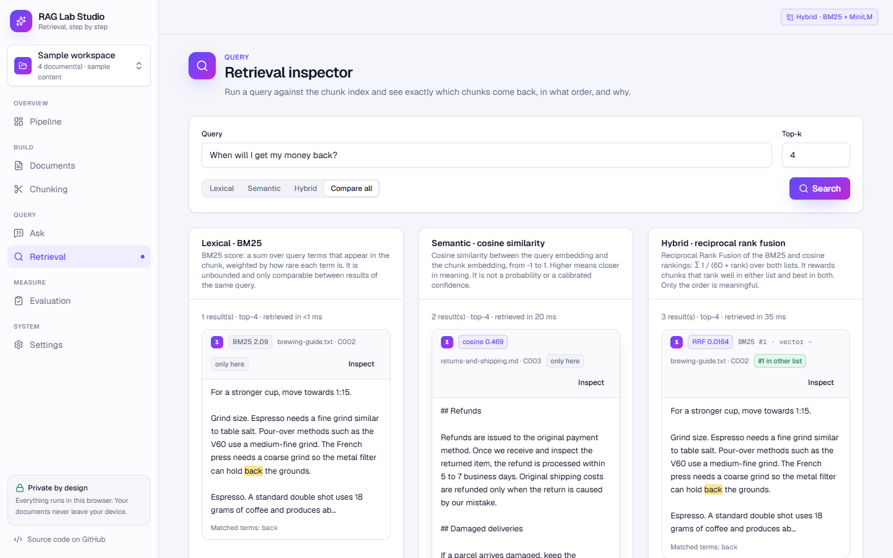
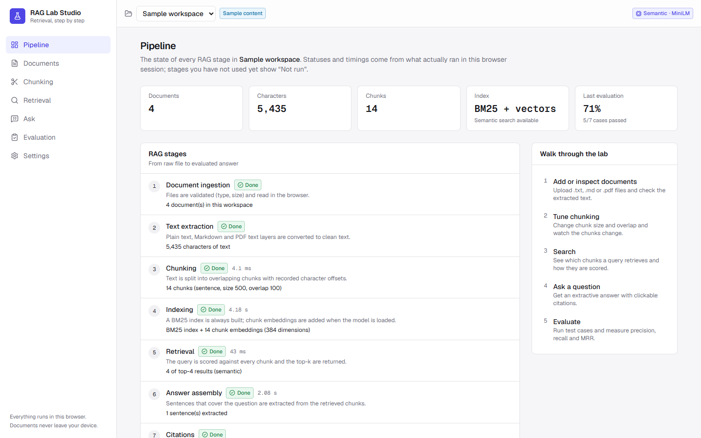
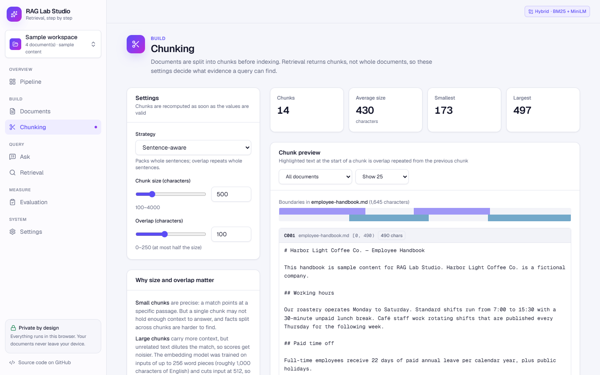
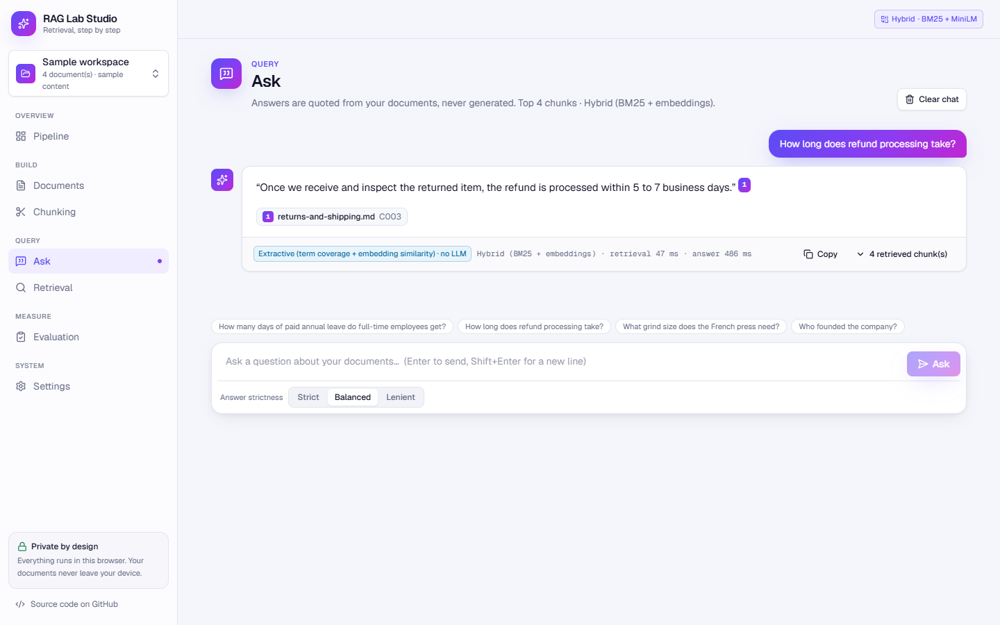
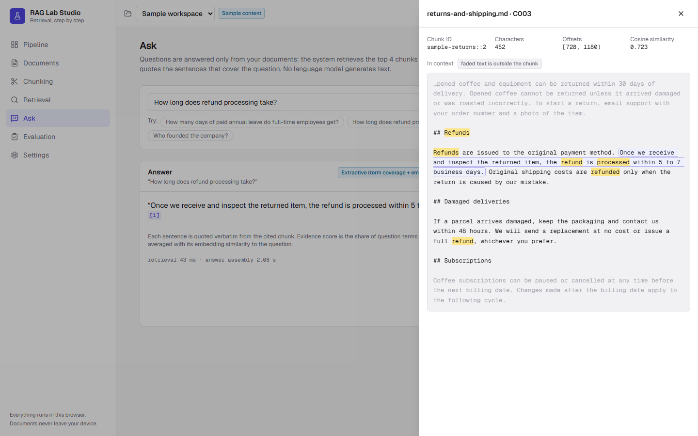
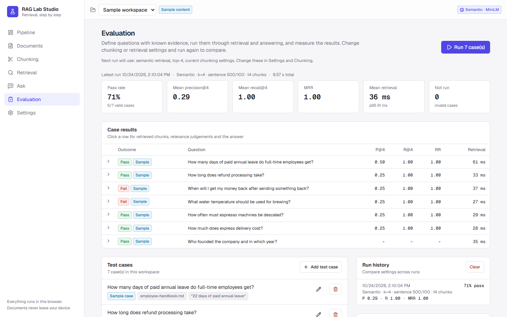
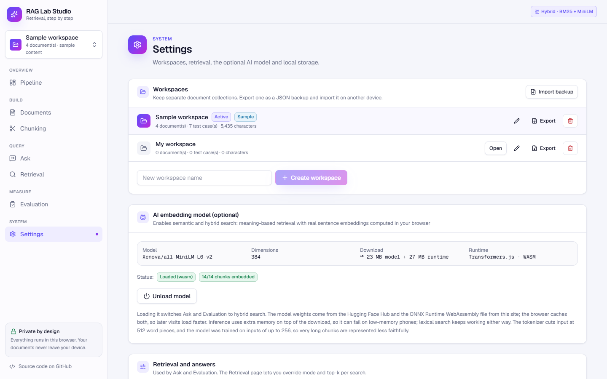
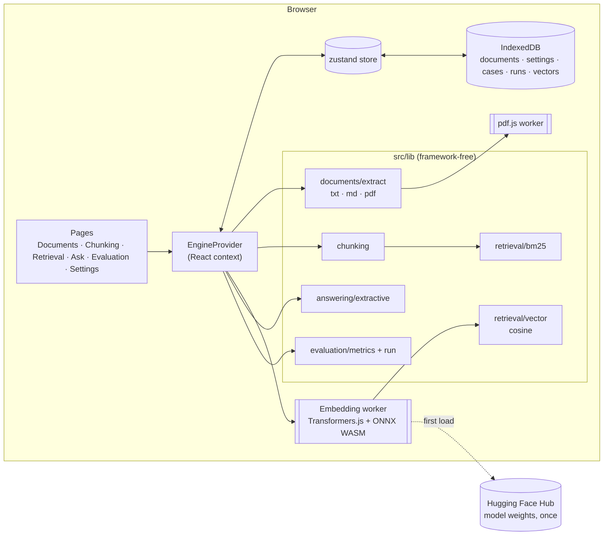

# RAG Lab Studio

An interactive lab that shows every stage of a Retrieval-Augmented Generation (RAG) pipeline, from raw file to evaluated answer. Upload documents, watch them get chunked, search them with BM25 or real sentence embeddings, ask questions that are answered with verifiable citations, and measure retrieval quality with your own test cases.

Everything runs in the browser. There is no backend, no API key and no database; documents never leave your device.

**Live demo:** https://rag-lab-studio.vercel.app



## Features

| Area | What you can do |
| --- | --- |
| **Documents** | Upload `.txt`, `.md` and text-based `.pdf` files (up to 10 MB each), inspect the extracted text, see per-file errors and warnings, remove documents. |
| **Chunking** | Switch between sentence-aware and fixed-size chunking, change size and overlap, and see chunk IDs, character offsets, sizes, overlap and a boundary map. Invalid settings are rejected, never applied. |
| **Embeddings** | Optionally download `all-MiniLM-L6-v2` and compute real 384-dimensional embeddings in a Web Worker with Transformers.js. Download progress and errors are shown as they happen. |
| **Retrieval** | Query the index with top-k, compare lexical (BM25) and semantic (cosine) results side by side, and inspect any chunk in the context of its document. |
| **Ask** | Get an extractive answer: sentences quoted verbatim from retrieved chunks, each with a clickable citation. When the evidence is too weak, the app says so instead of guessing. |
| **Evaluation** | Write test cases (question, expected documents, evidence phrases, expected facts, or "should decline"), run them, and get precision@k, recall@k, MRR, pass rate and latency. Run history lets you compare settings. |
| **Pipeline** | A live view of all eight stages with the status, timing and detail of what actually ran. |
| **Workspaces** | A clearly labelled *Sample workspace* with fictional documents and test cases, and an empty *My workspace* for your own files. |
| **Local data** | Everything is saved in IndexedDB. Reset the sample workspace or delete all local data from Settings. |

## Screenshots

These are real screenshots of the production build running on the sample workspace in Chrome.

| Pipeline | Chunking |
| --- | --- |
|  |  |
| **Ask with citations** | **Citation inspector** |
|  |  |
| **Evaluation** | **Settings** |
|  |  |

## Technology

- **Next.js 16** (App Router, all routes statically prerendered) with **React 19** and **TypeScript**
- **Tailwind CSS 4** with light and dark themes from CSS variables; **lucide-react** icons
- **Transformers.js 4** (`@huggingface/transformers`) running `Xenova/all-MiniLM-L6-v2` on ONNX Runtime WebAssembly in a Web Worker
- **pdf.js** (`pdfjs-dist` 6) for PDF text extraction, in its own worker
- **zustand** for state and **idb-keyval** for IndexedDB persistence
- **Vitest**, **React Testing Library** and **fake-indexeddb** for tests; ESLint with the Next.js config

## Architecture



- `src/lib` holds all algorithms as plain TypeScript with no React, so they are easy to test and reuse.
- `src/components/engine/EngineProvider.tsx` connects them to the UI: it derives chunks and the BM25 index from the documents, manages the embedding worker and vector cache, and exposes `uploadFiles`, `search`, `ask` and `runEvaluation`. It also records pipeline stage status and timing.
- `src/components/views` contains one component per page; `src/app` only defines routes and metadata.
- Answer generation is behind the `AnswerGenerator` interface (`src/lib/answering/types.ts`), so a local or browser-based generative model can be added later without changing retrieval, citations or evaluation.

## How the RAG pipeline works here

1. **Ingestion.** The file type is checked by extension and MIME type and the size is limited to 10 MB. Nothing is uploaded anywhere.
2. **Extraction.** Text files are decoded as UTF-8 (invalid bytes produce a warning; binary data is rejected). PDFs are parsed with pdf.js. Pages without a text layer produce a warning, and a PDF with no text at all is rejected: OCR is not supported.
3. **Chunking.** Text is split into chunks with recorded `[start, end)` offsets into the document.
4. **Indexing.** A BM25 index is always built. If the embedding model is loaded, every chunk is also embedded.
5. **Retrieval.** The query is scored against every chunk and the top-k are returned.
6. **Answer assembly.** Sentences from the retrieved chunks are scored against the question and the best ones are quoted.
7. **Citations.** Each quoted sentence carries a marker pointing to the chunk it came from.
8. **Evaluation.** Test cases are run through steps 5 to 7 and scored.

### Chunking

- **Sentence-aware** (default): whole sentences are packed into chunks of at most *size* characters. The next chunk starts with the trailing sentences of the previous chunk that fit within *overlap*, so overlap never cuts a sentence. A single sentence longer than *size* is split into fixed windows.
- **Fixed size:** windows of exactly *size* characters, each starting `size − overlap` characters after the previous one.

Size must be 100–4,000 characters and overlap 0 to size/2. These limits guarantee every step moves forward, so chunking can never loop. Small chunks give precise matches but may lack context; large chunks carry context but dilute the match. Overlap ensures a sentence near a boundary is fully inside at least one chunk.

### Retrieval: lexical vs semantic

| | Lexical (BM25) | Semantic (embeddings) |
| --- | --- | --- |
| Matches | Shared words (after lowercasing, stopword removal and light suffix stripping) | Meaning, via a 384-dimensional sentence embedding |
| Score | `Σ idf(t) · tf·(k1+1) / (tf + k1·(1 − b + b·len/avglen))` with k1 = 1.2, b = 0.75. Unbounded; only comparable within one query. | Cosine similarity `a·b / (‖a‖‖b‖)` in [−1, 1]. Results below a configurable minimum (default 0.2) are dropped. |
| Strength | Exact terms, names, numbers; no download | Paraphrases ("money back" → "refund") |
| Weakness | Fails when the question uses different words | Needs a ~23 MB model download; long chunks are embedded less faithfully |

Neither score is a probability or a calibrated confidence, and the UI never presents it as one. Lexical matching is always labelled "Lexical · BM25" and is never called semantic search.

The embedding model is `Xenova/all-MiniLM-L6-v2` (8-bit quantized ONNX, 22,972,370 bytes) with mean pooling and L2 normalisation. Its tokenizer cuts input at 512 word pieces, and the model was trained on inputs of up to 256, so very long chunks are represented less faithfully. Vectors are cached in IndexedDB, keyed by model and text hash, so unchanged chunks are not re-embedded.

### How answers and citations are produced

No language model writes text. The answerer is **extractive**:

1. Every sentence of every retrieved chunk is a candidate.
2. **Evidence score** = the IDF-weighted share of the question's content words that appear in the sentence. Rare, informative words count more, so "Who founded the company?" is not answered by a sentence that only mentions "company". In semantic mode the score is `0.5 · coverage + 0.5 · cosine(question, sentence)`.
3. If the best sentence scores below 0.5, the result is **insufficient evidence** and the reason is shown.
4. Otherwise up to three sentences within 75% of the best score are quoted, verbatim.
5. Each sentence links to its chunk. Citations are only ever created from retrieved chunks, and the inspector highlights the exact sentence inside the chunk and its document.

These thresholds are heuristics chosen for this demo, not tuned constants. The design deliberately prefers declining over answering wrongly.

### Evaluation metrics

A retrieved chunk is **relevant** if it comes from one of the case's expected documents (when given) and contains at least one evidence phrase (when given). Matching ignores case and whitespace.

| Metric | Definition |
| --- | --- |
| Precision@k | relevant chunks in the top k ÷ k. If fewer than k results are returned, it still divides by k. |
| Recall@k | evidence items found in the top k ÷ all evidence items. Items are the evidence phrases, or the expected documents if no phrases are given. Undefined (not shown) when a case has no ground truth. |
| Reciprocal rank | 1 ÷ rank of the first relevant chunk, or 0. **MRR** is the mean over cases. |
| Pass | recall@k = 1, the system answered, and every expected fact appears in the answer. A case marked "should decline" passes only if the system reports insufficient evidence. |
| Pass rate | passed ÷ cases that ran. Errors count as failures; invalid cases (e.g. missing ground truth) are reported separately and not run. |
| Latency | measured with `performance.now()` in your browser for each retrieval. |

Metrics are only shown after a run has actually happened. These metrics evaluate retrieval and simple fact matching; they are not a measure of overall answer quality the way a human reviewer would judge it.

**Observed on the sample workspace** (7 cases, sentence chunks 500/100, top-4; measured 2026-10-24; lexical by the test suite, semantic in Chrome on Windows): both modes pass 5 of 7 with mean P@4 0.29, R@4 1.00 and MRR 1.00. Retrieval finds the evidence for every case. The two failures are questions whose key words ("money", "temperature") never occur in the documents, so the extractive answerer declines. This limitation is kept visible on purpose; a generative answerer is the natural next step.

## Getting started

Requirements: Node.js 20.9 or newer and npm.

```bash
git clone https://github.com/husnainzahid050-hub/rag-lab-studio.git
cd rag-lab-studio
npm install
npm run dev
```

Open http://localhost:3000. The sample workspace loads automatically.

### Scripts

| Command | Purpose |
| --- | --- |
| `npm run dev` | Development server |
| `npm test` | Unit and interface tests (Vitest) |
| `npm run test:watch` | Tests in watch mode |
| `npm run lint` | ESLint |
| `npm run typecheck` | TypeScript (`tsc --noEmit`) |
| `npm run build` | Production build |
| `npm start` | Serve the production build |
| `npm run check` | Typecheck, lint, test and build in one go |

The test suite covers chunking edge cases, tokenisation, BM25 and cosine ranking, retrieval errors, extractive answering and citation integrity, every metric, evaluation validity rules, IndexedDB persistence, and PDF extraction with the real pdf.js on generated PDFs. Interface tests drive the real pages: upload, chunk settings, search, ask, citation inspection, evaluation runs, model loading (with a deterministic fake embedder) and clearing local data.

No environment variables are required.

## Deploying to Vercel

The app is a static Next.js build with no server code, so it fits the Vercel Hobby plan.

1. Push the repository to GitHub.
2. In Vercel, choose **Add New → Project** and import the repository. The framework is detected as Next.js; keep the default build command (`next build`).
3. Deploy. No environment variables are needed.

With the Vercel CLI: `npx vercel` for a preview, `npx vercel --prod` for production.

## Free-tier notes and limitations

- **Hosting:** only static assets are served, with no serverless functions or databases. The Vercel Hobby plan is for non-commercial use and has bandwidth limits. The largest asset is the 27 MB ONNX Runtime WebAssembly file, downloaded only when a visitor loads the embedding model.
- **Model download:** model weights (~23 MB) come from the Hugging Face Hub on first use and are then cached by the browser. If the Hub is unreachable, semantic mode is unavailable and lexical search keeps working.
- **Browser requirements:** a modern browser with WebAssembly and Web Workers (recent Chrome, Edge, Firefox or Safari). Inference uses memory on top of the download and can fail on low-memory phones; the app reports the error.
- **PDFs:** text-based PDFs only. Scanned PDFs (images) need OCR, which is not included. Layout such as columns and tables is flattened into plain text.
- **Scale:** every chunk is scored for each query (no approximate nearest-neighbour index). This is fine for a few hundred chunks but not for large collections.
- **Answers:** extractive answers quote sentences; they cannot combine facts or rephrase. Paraphrased questions are often declined.

## Data and privacy

- Files are read and processed in your browser. Document text never leaves the device.
- Documents, extracted text, settings, test cases, evaluation runs and cached embedding vectors are stored in the browser's IndexedDB for this site. They do not sync between browsers or devices, and clearing site data deletes them.
- Your data is never sent anywhere. Apart from the app's own pages and scripts, the only network requests go to the Hugging Face Hub for the model files, and only when you choose to load the model.
- Extracted text is rendered as plain text, never as HTML.
- **Settings → Clear all local data** deletes everything stored by the app.

## Future improvements

- A browser-based generative answerer (e.g. a small instruction-tuned model on WebGPU) behind the existing `AnswerGenerator` interface, still citing retrieved chunks
- Hybrid retrieval (BM25 + vectors with reciprocal rank fusion) and a reranker
- OCR for scanned PDFs, and DOCX/HTML import
- Import and export of workspaces and test suites as JSON
- An approximate nearest-neighbour index for larger collections

## License

MIT, see [LICENSE](LICENSE). Third-party components keep their own licenses: Transformers.js and pdf.js are Apache-2.0, ONNX Runtime is MIT, and the `all-MiniLM-L6-v2` model is Apache-2.0.

The sample documents describe a fictional company, "Harbor Light Coffee Co.", written for this project.
